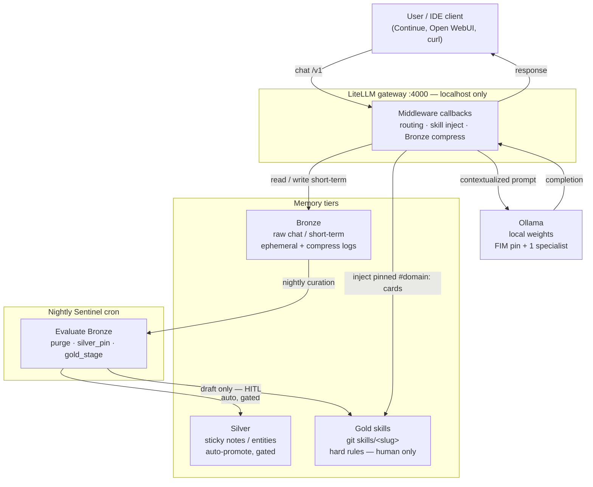

# Alfred architecture — strengths & weaknesses

Comparison baseline: typical homelab AI boxes — Open WebUI or LibreChat + Ollama on a 3060/4060, maybe one Compose file, rarely eval harnesses or estate-specific skills.

An Alfred-like stack is **not** competing with cloud agents. It is a **personal estate OS with local LLMs as a subsystem**. Grade it that way.

Hands-on path: [LEARNING_PATH.md](LEARNING_PATH.md). Middleware wire-up: [guides/wire-middleware.md](guides/wire-middleware.md).

## What this document is (and is not)

- **Is:** design notes from running a rails-heavy local lab, plus what this **public extract** actually ships.
- **Is not:** a ranking of other people’s labs. We don’t score the community; we describe tradeoffs.

## Verdict in one line

**Rails first, weights second.** Small local models need policy, measurement, and HITL or they feel broken. Treat the stack like ChatGPT and it will disappoint.

This public repo teaches a **subset** of those rails (skill inject, Bronze compress, keyword harness, Sentinel skeleton, curation gates). Full private labs often add more — see the honesty table below.

## Request flow & memory tiers

A request never goes “straight to the model.” It enters **LiteLLM middleware**, which (1) may compress or log **Bronze** short-term context when the transcript approaches specialist `num_ctx`, and (2) injects matching **Gold** skill cards (domain law from git, not vibes). The enriched prompt is what Ollama sees. Separately, a **nightly Sentinel** job curates Bronze: most of it is purged, some becomes **Silver** sticky memory under hard gates, and only **human-approved** drafts become Gold. Rails shape the 12GB box; weights fill the remaining slot.

Security posture (localhost binds, master key, HITL mutators): [SECURITY.md](SECURITY.md). Tier details: [guides/memory-tiers-curation.md](guides/memory-tiers-curation.md).

---

## What ships here vs private-lab extras

| Idea | In this public extract | Often private-only |
|------|------------------------|--------------------|
| `#domain:` + phrase → skill inject | Yes (`alfred_routing_skills.py`) | Applicability scoring / auto-merge transferable skills |
| Bronze rolling compress | Yes | Estate Chroma tenants, dual metadata keys |
| Gold skill cards | Example cards | Large personal registry + ingest |
| Eval | Keyword toy harness | Full matrices + optional Flash judge |
| Sentinel | Digest skeleton | Telemetry DB, mail, backup stages |
| Challenge → wire → drop | Pattern guide only | Host CLIs with smoke/rollback |
| Memory prune / Silver pin | Rubric + `route_score` demo | Nightly promote-and-prune job |

---

## Strengths worth copying

### 1. Estate-shaped Gold skills + explicit routing
Most labs dump a system prompt and pray. Domain IDs, phrase triggers, inject caps, and optional `#domain:` force-routes beat vibes. **This extract:** `#domain:` + `domains.yaml` phrases. Applicability judges are a private upgrade.

### 2. Fail-closed host ops
Preflight mounts / UUIDs, VRAM flock, MemAvailable thresholds, DOCKER-USER awareness, refuse dangerous on-metal paths — **homelab adulting**. Many AI boxes happily OOM and republish MySQL to `0.0.0.0`. (Most of that ops surface is private; the `docker-ufw` / `safe-script` cards teach the scars.)

### 3. Measured trust, not vibes
A fixed challenge pack with PASS/FAIL gates catches silent skill regressions. Optional cloud judges are useful **if** you keep HITL and never auto-promote from a score alone. **This extract:** keyword gates only.

### 4. Honest VRAM model
FIM (small autocomplete) **pinned** in slot-1; one specialist **hot-swapped** in slot-2 on 12GB-class boxes. Pretending three 7Bs “fit” kills autocomplete clients that expect a warm FIM model.

### 5. HITL as constitution
Digests, Spec Kit drafts, staged model wires — **signal not authority**. “Autonomous agents” in a homelab often end at a bad `rm` or firewall rule.

### 5b. Memory tiers with prune
Bronze capture is cheap; Silver auto-promote is gated; Gold is **human-only**. Nightly rubric + purge keeps Chroma from filling with vibes — see [guides/memory-tiers-curation.md](guides/memory-tiers-curation.md). **This extract:** gates + checklist; not the full cron job.

### 6. Plan vs implement split
Separate **planner** and **coder** aliases beat “paste megaprompt into Agent.”

### 7. Bronze rolling context
When messages (+ tools) approach specialist `num_ctx`, compress the middle (threshold ≈ 0.61 × ctx) instead of silent empty streams — see [guides/bronze-budgets.md](guides/bronze-budgets.md).

### 8. Challenge → wire → drop
Pull a candidate, A/B against an alias, wire with smoke/auto-rollback, or drop weights cleanly. Prefer baseline when pass rates **tie**; smaller `num_ctx` is a real regression. **This extract:** the pattern; CLIs stay private — [guides/model-challenge-wire-drop.md](guides/model-challenge-wire-drop.md).

---

## Parity with good labs (not unique)

- Ollama + LiteLLM + Open WebUI / Continue
- Optional local websearch inject
- Security specialist model (narrow but smart)
- Email digests / cron ops
- 8k–32k chat contexts — adequate, not frontier

---

## Weaknesses (be honest with adopters)

### Effectiveness limiters

1. **Small weights.** 7B/9B will not match frontier cloud models for hard reasoning or large refactors. You win on **estate recall**, lose on **general intelligence**. Budget truth: better GPU later or accept cloud for hard problems.

2. **Operator tax.** Right alias, `#domain:`, review drafts. Untagged chat is mediocre. Either embrace the tax or invest in better auto-routing UX privately.

3. **Cold-load / hot-swap friction.** Slot-2 eviction feels like “the stack forgot” unless clients and docs set expectations.

4. **Routing / skill inject brittleness.** Wrong domain or invented skill names waste a turn. Eval packs catch some of this; users still need discipline.

### Ops debt

5. **Public extract lag.** This tree is a sanitized subset; it will always trail a live private lab. That is intentional.
6. **Judge ≠ truth.** Cloud judge scores follow harness gates; infra flakes (`Connection refused`) look like model failure.
7. **Security surface.** Master keys, published ports, tool servers — Compose examples must default to localhost binds.

---

## Recommended alias map (example)

| Alias | Role | Notes |
|-------|------|-------|
| `alfred-fim` | Autocomplete / FIM | Small base model, pinned, ~8k |
| `alfred-coder` | Coding + tools | Instruct chat, OpenAI-compat `/v1` |
| `alfred-reasoner` | General reason | May need `think:false` on thinking models |
| `alfred-technical-planner` | Spec / plan only | Never implement |
| `alfred-security` | Exposure / hardening review | Often smaller ctx for VRAM |

Tune `num_ctx` per alias and keep Bronze thresholds in sync. Example Compose ships **coder + reasoner** only; add FIM when you want real Bronze summaries.

---

## Design principles (steal these)

1. **Aliases, not raw tags**, in clients — rewire backends without teaching every tool a new name.
2. **Skills are law for a domain**; system prompts are soft.
3. **Fail closed** on mounts, publishes, and destructive scripts.
4. **Measure before promote** — challenge packs, then wire, then drop if wrong.
5. **HITL for anything that mutates** hosts, firewalls, or production config.
