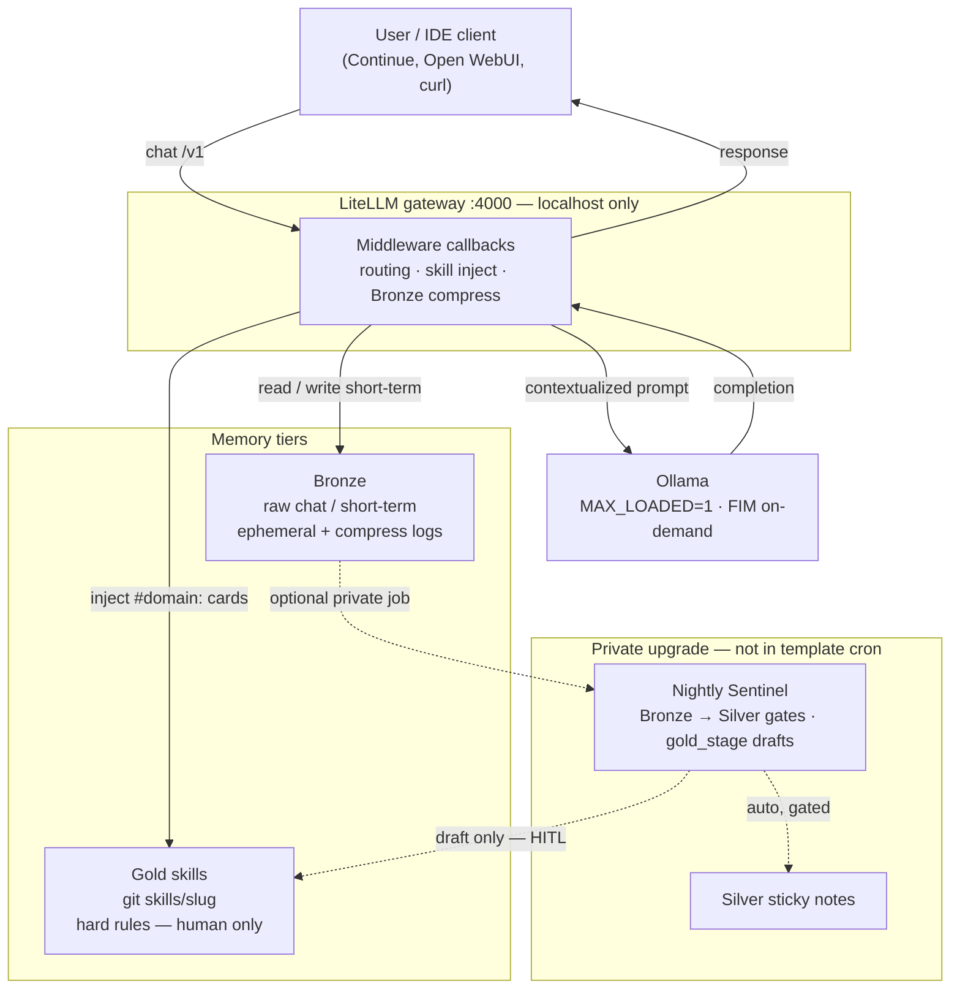

# Alfred architecture — template view

This repo is a **local-LLM lab pattern**: aliases, skill inject, Bronze compress,
and HITL — not a cloud agent product and not a full private lab dump.

Hands-on: [../README.md](../README.md) → bootstrap → smoke. Depth: [LEARNING_PATH.md](LEARNING_PATH.md).
Security posture: [SECURITY.md](SECURITY.md). Honesty map: [PRIVATE_VS_TEMPLATE.md](PRIVATE_VS_TEMPLATE.md).

## One-line summary

**Rails first, weights second.** On a 12GB-class box, small models need routing
and budgets or long chats fall over. This template ships a **sanitized subset**
of those rails plus a **reference alias → backend map** (not anyone’s private tree).

## What ships here

| Idea | In template |
|------|-------------|
| `#domain:` + phrase → skill inject | Yes (`middleware/alfred_routing_callback.py`) |
| Soft skill cards on keyword path | Yes (full Gold on phrase / explicit tag / `#load_skill`) |
| Bronze rolling compress | Yes (self-summarize → FIM fallback) |
| Ops-core Gold | Six skills under `skills/` |
| Alias map (14B coder / 9B reasoner+planner / Foundation-Sec) | Yes (`deploy/compose` + `deploy/modelfiles`) |
| Eval / Sentinel / challenge CLIs | Pattern + `examples/` only |
| SearXNG / stack monitor / judge | Private upgrade |

## Request flow & memory tiers

A request never goes “straight to the model.” It enters **LiteLLM middleware**,
which (1) may compress **Bronze** short-term context when the transcript
approaches specialist `num_ctx`, and (2) injects matching **Gold** skill cards.
The enriched prompt is what Ollama sees.

**Nightly Sentinel → Silver** is available as a sanitized package under
`examples/sentinel/` (memory stage off by default; enable with env). Dashed
edges in the diagram are not started by Compose alone. **Gold stays human-only.**

Tier details: [guides/memory-tiers-curation.md](guides/memory-tiers-curation.md).

## Intended use (co-pilot)

Useful jobs for this stack:

1. Monitor the lab  
2. Draft code / config for **human** review  
3. Capture reusable fixes as Gold skills  
4. Coach rough notes into clearer agent prompts  

It is a poor fit for unsupervised “approve the plan and implement everything”
loops. Prefer explicit `#domain:` / Coach, one task at a time, and HITL on
anything that mutates the host.

## Alias map (ships with this template)

Reference defaults for a **12GB-class** GPU lab. Bootstrap pulls base weights,
then `ollama create`s Modelfiles under [`deploy/modelfiles/`](../deploy/modelfiles/).
Override via `.env` / Modelfiles if your VRAM or taste differs.

| Alias | Ollama tag | Base pull | Ctx | Role |
|-------|------------|-----------|-----|------|
| `alfred-coder` | `alfred-coder-14b` | `qwen2.5-coder:14b-instruct-q3_K_M` | 16k | Implement / tools |
| `alfred-reasoner` | `alfred-reasoner` | `qwen3.5:9b` | 32k | Coach / general reason |
| `alfred-technical-planner` | `alfred-planner` | `qwen3.5:9b` | 32k | Spec / plan drafts only |
| `alfred-security` | `alfred-foundation-sec` | Foundation-Sec-8B-Instruct Q4 (HF GGUF) | 16k | Exposure / hardening review |
| `alfred-fim` | `qwen2.5-coder:1.5b-base` | same | 8k | Bronze `/api/generate` fallback only |

When the client sends `tools[]`, routing rewrites `alfred-reasoner` /
`alfred-technical-planner` to hidden `*-fc` twins (`openai/*`) so tool_calls
stream as structured calls instead of JSON-in-content. Chat without tools stays
on `ollama/*` + `think: false` for qwen3.5. FIM never accepts tools.

**VRAM:** `OLLAMA_MAX_LOADED_MODELS=1` — one chat specialist resident. FIM is
**not** permanently pinned; soft-keep only for Bronze. See
[`skills/vram-runtime`](../skills/vram-runtime/SKILL.md).

Keep [`bronze_budgets.yaml`](../deploy/compose/litellm/bronze_budgets.yaml) in
sync whenever you change `num_ctx`.

## What this pattern is trying to fix

These are **design choices**, not claims that Alfred is uniquely clever. Other
labs solve the same problems differently.

1. **Domain skills + routing** — a short Gold card for a known failure mode is
   easier to maintain than one giant system prompt. Wrong domain still wastes a turn.  
2. **Localhost / DOCKER-USER defaults** — published ports on a home LAN are a
   common foot-gun; the template documents fail-closed habits, not a firewall product.  
3. **VRAM honesty** — `MAX_LOADED=1`, KV q8_0, FIM on-demand. Avoids pretending
   several chat models fit at once on 12GB-class hardware.  
4. **HITL on mutators** — digests and drafts are suggestions. Scripts that touch
   firewalls or disks stay human-gated (`safe-script-production`).  
5. **Separate planner vs coder aliases** — different SYSTEM prompts and ctx;
   the human still switches the client. It does not auto-handoff.

## Tradeoffs and limits

1. **Local weights.** 14B / 9B will not match frontier cloud models on hard
   reasoning or large refactors. Lab-specific recall helps; general IQ does not.  
2. **Operator work.** You pick aliases and tags (`#domain:`, Coach). Untagged
   chat is usually average.  
3. **Cold loads.** With one resident model, alias switches cost seconds (sometimes
   transient errors until load finishes). Batch jobs should retry/backoff.  
4. **Disk and time.** Day-1 pulls (14B Q3 + 9B + Foundation-Sec) are tens of GB.  
5. **Incomplete by design.** Search, digests, DR, and personal skills stay private
   upgrades — this tree will always look “thin” next to a full lab.  
6. **One box.** Putting gateway + weights on a single GPU host is a single point
   of failure if that machine is down.
