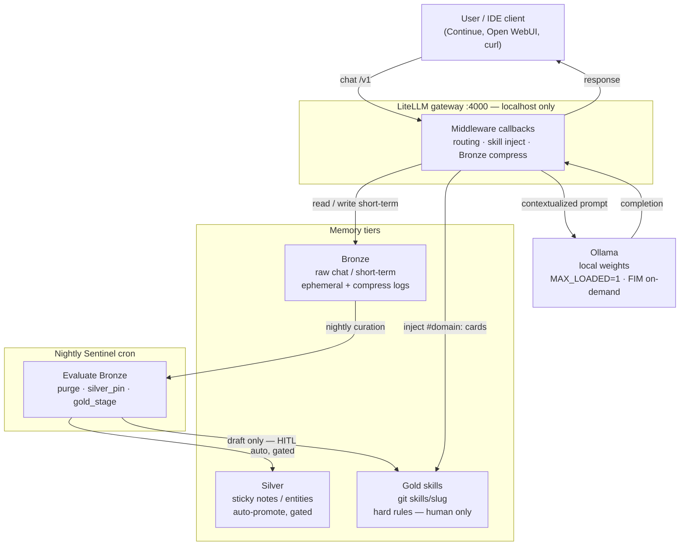

# Alfred architecture — template view

Alfred is a **personal lab OS with local LLMs as a subsystem**, not a cloud agent.
Grade it on rails + HITL, not demo wow.

Hands-on: [../README.md](../README.md) → bootstrap → smoke. Depth: [LEARNING_PATH.md](LEARNING_PATH.md).
Security posture: [SECURITY.md](SECURITY.md).

## Verdict in one line

**Rails first, weights second.** Small local models need policy and measurement
or they feel broken. This template ships a **sanitized subset** of those rails.

## What ships here

| Idea | In template |
|------|-------------|
| `#domain:` + phrase → skill inject | Yes (`middleware/alfred_routing_callback.py`) |
| Soft skill cards on keyword path | Yes (full Gold on phrase / explicit tag / `#load_skill`) |
| Bronze rolling compress | Yes (self-summarize → FIM fallback) |
| Ops-core Gold | Six skills under `skills/` |
| Eval / Sentinel / challenge CLIs | Pattern + `examples/` only |
| SearXNG / stack monitor / judge | Private upgrade |

## Request flow & memory tiers

A request never goes “straight to the model.” It enters **LiteLLM middleware**,
which (1) may compress **Bronze** short-term context when the transcript
approaches specialist `num_ctx`, and (2) injects matching **Gold** skill cards.
The enriched prompt is what Ollama sees. A full **nightly Sentinel** (private
upgrade; skeleton under `examples/sentinel/`) may curate Bronze → Silver under
gates; **Gold stays human-only**.

Tier details: [guides/memory-tiers-curation.md](guides/memory-tiers-curation.md).
Honesty map: [PRIVATE_VS_TEMPLATE.md](PRIVATE_VS_TEMPLATE.md).

## Co-pilot product (not autonomy)

1. Monitor the lab  
2. Draft code / config — human reviews  
3. Capture reusable fixes as Gold  
4. **Coach prompts** into agent-optimized messages  

Retired fantasy: unsupervised “approve plan / implement one” lanes. Prefer
Gold tags + one-task handoffs + HITL.

## Strengths worth copying

1. **Estate-shaped skills + routing** beat a single system prompt.  
2. **Fail-closed publishes** (DOCKER-USER, localhost) — homelab adulting.  
3. **Honest VRAM:** `OLLAMA_MAX_LOADED_MODELS=1`, KV q8_0, FIM not pinned.  
4. **HITL as constitution** — digests and drafts are signal, not authority.  
5. **Plan vs implement split** — planner alias, then coder for one task.

## Weaknesses (tell adopters)

1. **Small weights.** 7B-class tags will not match frontier cloud IQ.  
2. **Operator tax.** Right alias + `#domain:` / Coach. Untagged chat is mediocre.  
3. **Cold-load friction** under MAX_LOADED=1 — swapping aliases costs time.  
4. **Template lag.** Private labs always have more surface; that is intentional.  
5. **Single-node SPOF** if you put everything on one GPU box.

## Alias map (template defaults)

| Alias | Default Ollama tag | Role |
|-------|-------------------|------|
| `alfred-coder` | `qwen2.5-coder:7b-instruct` @16k | Implement / tools |
| `alfred-reasoner` | `qwen2.5:7b-instruct` @16k | Coach / reason |
| `alfred-technical-planner` | same instruct @16k | Spec / plan drafts |
| `alfred-fim` | `qwen2.5-coder:1.5b-base` @8k | Bronze fallback only |

Private labs may wire 14B coder Modelfiles and larger planner ctx — optional.

## Soft / deferred skills

Park future projects under `skills/_soft/` (not injected). Promote when the
hardware/project is real. See private pattern; not required for day-1 smoke.
